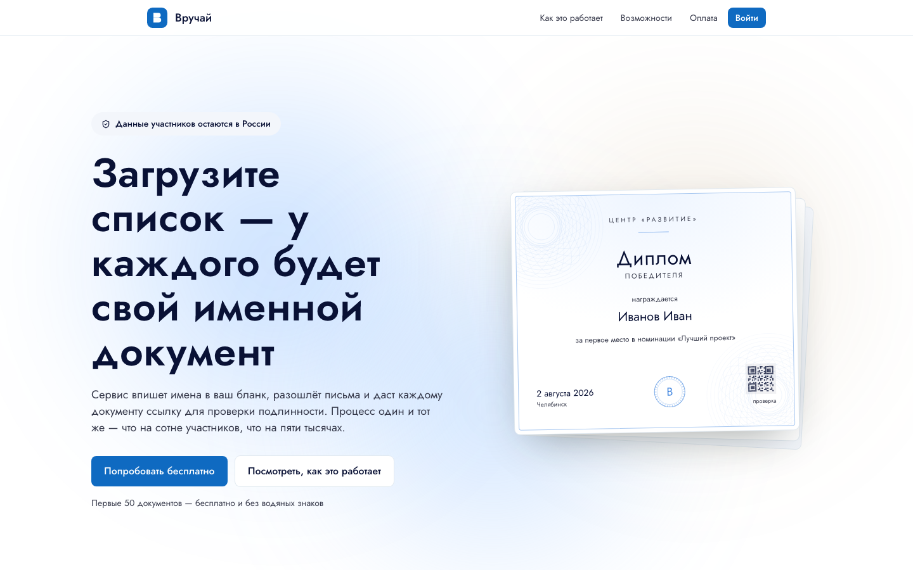
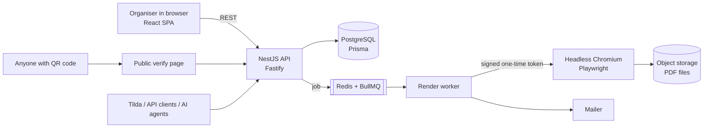

# Vruchay — named certificates at scale, with verification

**Live:** [vruchay.ru](https://vruchay.ru) · **Status:** in production, paid plans · **Source:** private (commercial product). This repository is the public overview.

Organisations upload a list of participants and a certificate template. Vruchay renders a personal PDF for every person, sends it by email, and gives each document a public page where anyone can check that it is genuine.

## Why it exists

Sports federations, schools and event organisers in Russia issue hundreds of diplomas after every competition. They usually do it by hand in Word or Canva: names typed one by one, no way to prove a certificate is real, and participant data sent to foreign services, which breaks Russia's personal-data law (152-FZ).

Vruchay turns that into one upload. Data stays on Russian servers.

## What it does

| | |
| --- | --- |
| **Bulk generation** | Table of participants + template → one PDF/JPEG per person, rendered in a background queue |
| **Correct Russian grammar** | Full names are declined into the right grammatical case ("awarded to Ivanova Anna" → «Ивановой Анне») |
| **Award rules** | Import competition results; places and ranks are turned into the right diploma automatically |
| **Verification** | Every document gets a number, a QR code and a public page confirming who issued it |
| **Mailing** | Personal emails with the document, with a delivery log |
| **Integrations** | Tilda forms, public REST API, and machine-readable docs for AI agents ([llms-full.txt](https://vruchay.ru/llms-full.txt)) |
| **Business** | Organisations, teams and roles, plans from 29 000 to 149 000 ₽/year, invoices, payments |

## Architecture

- **Monorepo** (pnpm): `apps/server`, `apps/web`, and `packages/shared`, the single contract for the template schema, used by the editor, the preview and the server renderer, so what you see is exactly what gets printed.
- **Rendering** runs in a separate worker process. Chromium opens a page by a signed one-time token, never with the user's session.
- **Security by default:** organisation ownership is checked on the server for every object (no IDOR), sessions are encrypted, and CI runs Gitleaks, Semgrep, dependency audits and Trivy image scans on every push.
- **Ops:** Docker Compose, Caddy, staging and production pipelines in GitHub Actions, backup and restore drills.

## Numbers

| | |
| --- | --- |
| First commit | 31 July 2026 |
| Commits | 420+ in two months |
| Test files | 176 (unit + integration, Vitest) |
| Server modules | 40+ (documents, awards, render, verify, mailing, payments, signing, audit…) |
| Architecture decisions | written down as ADRs |

## My role

I am the lead developer. I wrote most of the code (~78% of commits): the product architecture, the template editor and the rendering pipeline, the organiser dashboard and the landing page. I work together with co-founder [Nikita Borozdov](https://github.com/borozdov).

I build with AI coding agents. I write the rules, architecture decisions and tests that keep them in check, and I review every change. The repository's `CLAUDE.md` is that rulebook.

## Stack

TypeScript · NestJS · Fastify · Prisma · PostgreSQL · Redis · BullMQ · Playwright · React · Vite · Zod · Docker · Caddy · GitHub Actions

---

Sofia Guliaeva · [github.com/sofya0206](https://github.com/sofya0206)
